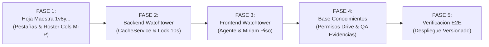

# Especificación de Diseño Técnico Definitivo: Ecosistema Unificado TIP México
**Versión:** 3.0.0 (Blindada post-auditoría EGM Swarm)  
**Estado:** APROBADO TÉCNICAMENTE (READY FOR IMPLEMENTATION)  
**Repositorios:** [`tip-state-controller`](file:///c:/Users/SDVP/Documents/GitHub/tip-state-controller), [`tip-base-conocimiento`](file:///c:/Users/SDVP/Documents/GitHub/tip-base-conocimiento), [`tip-direccion`](file:///c:/Users/SDVP/Documents/GitHub/tip-direccion)

---

## 1. Topología Bipolar Inmutable y Separación de Cadencias

1. **TIP Watchtower (Consola Operativa, WFM y Tráfico en Vivo)**:
   - **URL Oficial:** `https://script.google.com/a/macros/telat-group.com/s/AKfycbwUdK-lrv94JSUcLvjqGbROxNoTq1qc0rgWN4qh5Yv6naaYDXLArpe-bynxvTvdCSJ9UQ/exec`
   - **Repositorio base:** `c:\Users\SDVP\Documents\GitHub\tip-state-controller`
   - **Cadencia:** Tiempo real continuo (segundos/minutos).
   - **Perfil Agente:** Selector de estado con cronómetro reactivo y panel deslizable del **Checklist de Ticket (6 puntos)**.
   - **Perfil Supervisor (Miriam / Ricardo):** Monitoreo de piso en vivo (vía `CacheService`), semáforos individuales de adherencia por agente y acceso exclusivo a `QA Engine`.

2. **TIP Knowledge Hub (Base de Conocimientos y Seguimiento QA)**:
   - **URL Oficial:** `https://script.google.com/a/macros/telat-group.com/s/AKfycbyC_ChIHi7PneJfexJqabTjVNUFt9IWBonIBfDS-jTzNUKOD1L2wNhNSSN0octBIM4K/exec`
   - **Repositorio base:** `c:\Users\SDVP\Documents\GitHub\tip-base-conocimiento`
   - **Cadencia:** Transaccional bajo demanda durante llamadas y auditorías.
   - **Capacidades:** Matriz de atención, plantillas para Salesforce, expediente con hilo de notas acumulativo, evidencias con compresión canvas y visualizador de manuales con permisos abiertos para `@telat-group.com`.

3. **Compilador Semanal para Laura Mercado (`layout_data_repli.xlsx` 85 columnas)**:
   - **Cadencia:** Lote semanal (cierre de viernes).
   - **Arquitectura de Ejecución:** Para no saturar los 6 minutos de timeout de Apps Script ni degradar estilos binarios con SheetJS, la compilación de las 85 columnas se mantiene en el motor probado en Python [`convertir_layout_tip.py`](file:///c:/Users/SDVP/Documents/GitHub/tip-direccion/scripts/convertir_layout_tip.py) mediante un lanzador de 1 clic en Windows (`Compilar-Reporte-Laura.bat`). Miriam selecciona los archivos en su carpeta de descargas y el Excel se genera idéntico a la plantilla binaria en 3 segundos.

---

## 2. Gobernanza de Base de Datos (Hoja Maestra `1v8yIJcFceKNXQD6hpng2C7IALGm_UXT9RwQLf5l95jM`)

### 2.1 Pestaña `Roster TIP` (Preservación estricta de las 12 columnas base + 4 columnas WFM)
*Regla crítica auditada: Se prohíbe el uso de `ss.getSheets()[0]`. La hoja se invoca exclusivamente con `ss.getSheetByName("Roster TIP")` para evitar colapsos al agregar nuevas pestañas.*

| Col | Letra | Campo | Tipo / Uso en Código |
| :---: | :---: | :--- | :--- |
| 0 | A | `#` | Índice numérico |
| 1 | B | `Nombre Completo` | Nombre completo del colaborador |
| 2 | C | `Primer Nombre y Apellido` | Nombre corto en tarjetas de piso |
| 3 | D | `Rol` | `AGENTE`, `SUPERVISOR`, `GERENTE`, `ADMIN` |
| 4 | E | `Cuenta Bria` | Credencial PBX |
| 5 | F | `Password` | Contraseña |
| 6 | G | `Extension` | Extensión telefónica (2001-2007) |
| 7 | H | `Agentes` | Etiqueta de agente |
| 8 | I | `Email` | Correo oficial `@telat-group.com` |
| 9 | J | `Estatus` | `ACTIVO` / `BAJA` (Soft delete) |
| 10 | K | `Visible_Muro` | `SI` / `NO` (Protege a directivos del muro público) |
| 11 | L | `Notas` | Observaciones |
| 12 | **M** | `Shift_Clave` | **Clave de jornada (`7:00`, `7:30`, `8:00`, `8:30`, `10:00`, `11:00`)** |
| 13 | **N** | `Horario_Entrada` | **Hora de inicio en CDMX (ej. `08:30`, `10:00`, `11:00`)** |
| 14 | **O** | `Horario_Salida` | **Hora de término en CDMX (ej. `15:30`, `17:00`, `18:00`)** |
| 15 | **P** | `Ventanas_Auxiliares`| **Horarios programados de comida y descansos** |

### 2.2 Pestaña `Matriz_WFM` (Catálogo Completo de Jornadas Reales de TIP México)
*Incorpora de forma obligatoria las jornadas de 10:00 y 11:00 auditadas en las extensiones 2004 a 2007.*

| Shift_Clave | Comida_Segs | Comida_Tolerancia | Break_Segs | Sanitario_Segs | Total_Aux_Segs |
| :---: | :---: | :---: | :---: | :---: | :---: |
| `6:00` | 1200 (20m) | 60 | 600 (10m) | 660 (11m) | 2460 (41m) |
| `7:00` | 1200 (20m) | 60 | 900 (15m) | 660 (11m) | 2760 (46m) |
| `7:30` | 1200 (20m) | 60 | 900 (15m) | 660 (11m) | 2760 (46m) |
| `8:00` | 1800 (30m) | 60 | 900 (15m) | 900 (15m) | 3600 (60m) |
| `8:30` | 1800 (30m) | 60 | 900 (15m) | 900 (15m) | 3600 (60m) |
| `9:00` | 1800 (30m) | 60 | 900 (15m) | 900 (15m) | 3600 (60m) |
| **`10:00`** | **1200 (20m)** | **60** | **900 (15m)** | **660 (11m)** | **2760 (46m)** |
| **`11:00`** | **1200 (20m)** | **60** | **900 (15m)** | **660 (11m)** | **2760 (46m)** |

### 2.3 Pestaña `Catalogo_Colas`
`Cola_Conmutador | Desvio_PBX | Clave_Canonica | Nombre_Cuenta | Numero_800 | Prefijo_CallerID | Activo`
*Almacena 8001 a 8009 (General, Bitcar, OFS, JAC, KIA, MG, GCO, Chirey, Carnot).*

### 2.4 Pestaña `Config_Parametros`
`TIMEZONE_OFICIAL = America/Mexico_City`, `SLA_META_SEGUNDOS = 20`, `URL_QA_ENGINE = https://tip-qa-engine-263606521887.us-central1.run.app/`, `ID_CARPETA_DRIVE_EVIDENCIAS = 0ABDMGdVpPZpHUk9PVA`.

---

## 3. Concurrencia Robusta y Seguridad en Backend

1. **Prevención de Pérdida Silenciosa de Datos (`No-Silent-Drop`):**
   ```javascript
   const lock = LockService.getScriptLock();
   if (!lock.waitLock(10000)) {
     throw new Error("El servidor está ocupado procesando otro cambio de estado. Por favor reintenta en un instante.");
   }
   try {
     // Escritura de Estado_Actual y Bitacora_Estados
   } finally {
     lock.releaseLock();
   }
   ```
2. **Caché Atómica por Extensión:**
   - Para evitar condiciones de carrera entre agentes, cada extensión tiene su propia clave en `CacheService`: `tip_agent_state_${ext}`.
   - El muro de supervisión consulta una función agregadora que lee las 8 claves y, ante cualquier *Cache Miss*, rehidrata automáticamente desde la pestaña `Estado_Actual`.
3. **Server-Side Gating en Mutadores Administrativos:**
   Toda función de mutación (`reiniciarJornadaCompleta`, `forzarEstadoSupervisor`) valida el rol de llamada en la primera línea mediante `Session.getActiveUser().getEmail()` contra la pestaña `Roster TIP`. Si no es `ADMIN` o `SUPERVISOR`, arroja excepción de seguridad y no se ejecuta.
4. **Purga de QA Engine:**
   La URL de `QA Engine` solo se inyecta en el payload de respuesta de `obtenerPerfilUsuario()` si el rol verificado es `SUPERVISOR`, `GERENTE` o `ADMIN`. Para el perfil `AGENTE`, el campo se envía nulo y el botón no existe en el DOM.

---

## 4. Solución Integral a los Requerimientos Operativos de Miriam (Base de Conocimientos)

### 4.1 Hilo Cronológico de Notas QA (Auditoría Acumulativa)
- Se erradica la sobreescritura con `setValue()`.
- La columna `NOTAS_QA` almacena un array serializado JSON:
  ```json
  [
    {"fecha": "2026-11-10 12:45:00", "autor": "mtotomocht@telat-group.com", "texto": "Se detectó omisión en póliza de seguro."},
    {"fecha": "2026-11-10 13:10:00", "autor": "rgarcia@telat-group.com", "texto": "Asesor corrigió en Salesforce. Caso subsanado."}
  ]
  ```
- El expediente renderiza un timeline vertical con fecha en formato CDMX y autor.
- Al guardar la evaluación QA, el modal **no se cierra intempestivamente**: muestra una confirmación visual inline con check verde y fecha de guardado.

### 4.2 Módulo de Capturas de Pantalla y Evidencias con Compresión Canvas
- Se agrega en `Index.html` un listener de `paste` (`Ctrl + V`) y un botón para adjuntar imagen.
- **Blindaje anti-payload:** Antes de enviar el Base64 a Apps Script, el navegador redimensiona la captura mediante HTML5 Canvas (máximo 1280px de ancho, formato `image/jpeg` con calidad 0.75), reduciendo el peso de 6 MB a menos de 450 KB, cumpliendo holgadamente el límite de `google.script.run`.
- **Persistencia:** Se añade la columna 24 `URL_EVIDENCIAS` a `BITACORA_HEADERS_CANONICOS` en [`Database.js`](file:///c:/Users/SDVP/Documents/GitHub/tip-base-conocimiento/Database.js).
- **Miniaturas:** La miniatura se renderiza usando el endpoint oficial de Google Drive:
  `https://drive.google.com/thumbnail?id=${fileId}&sz=w250`.

### 4.3 Rediseño de Columna 1 y Pipeline de 5 Etapas
- **Erradicación del badge "PENDIENTE":**
  - Si el ticket aún no tiene folio capturado, se muestra el botón: `[ + Ingresar Folio ]`.
  - Si ya tiene folio, se muestra como titular en azul: `CASO #048912`.
  - Debajo del folio se sitúa el badge de la etapa del proceso.
- **Máquina de estados y conciliación con el motor de SLA:**
  - **Etapas activas (computan en SLA de días hábiles):** `NUEVO / ASIGNADO`, `EN GESTIÓN / ESCALADO N1-N2`, `PENDIENTE CLIENTE`.
  - **Etapas terminales (detienen el reloj de SLA y registran `FECHA_CIERRE`):** `CONCLUIDO / CERRADO`, `CANCELADO`.

### 4.4 Blindaje de Permisos en Manuales de Google Drive
- En [`IngestaIA.js`](file:///c:/Users/SDVP/Documents/GitHub/tip-base-conocimiento/IngestaIA.js) y [`Database.js`](file:///c:/Users/SDVP/Documents/GitHub/tip-base-conocimiento/Database.js), toda subida ejecuta en bloque tolerante a Shared Drives:
  ```javascript
  try {
    file.setSharing(DriveApp.Access.DOMAIN_WITH_LINK, DriveApp.Permission.VIEW);
  } catch (err) {
    console.warn("Permiso heredado de Unidad Compartida: " + err.message);
  }
  ```
- Se implementa la función `desbloquearManualesExistentes_()` para barrer la pestaña `Manuales` y garantizar que todos los manuales activos sean visibles inmediatamente para `@telat-group.com`, eliminando la pantalla de "Necesitas acceso".

---

## 5. El Checklist de Validación de Ticket (6 Puntos)

El panel lateral deslizable en la Watchtower preserva los 6 puntos canónicos requeridos por Calidad y Miriam:
1. **Tríada de contacto obligatoria:** Nombre, Teléfono y Correo validados en llamada.
2. **Identificación vehicular:** Económico / Placas / VIN confirmados contra el contrato.
3. **Tipificación en Salesforce:** Selección correcta de tipo y motivo de caso.
4. **Carga de evidencias:** Póliza, tarjeta de circulación o formato de servicio adjunto.
5. **Acuerdos y compromisos:** Tiempo de respuesta oficial informado al cliente según SLA.
6. **Cierre formal:** Agradecimiento institucional y ofrecimiento de encuesta de satisfacción.

---

## 6. Plan de Trabajo e Implementación por Fases (Phased Implementation Roadmap)



* **Fase 1 (Base de Datos Maestra):**
  - Anexar columnas M, N, O, P a `Roster TIP` en la hoja `1v8y...5jM` y poblar turnos reales (incluyendo 10:00 y 11:00).
  - Sembrar pestañas `Matriz_WFM`, `Catalogo_Colas` y `Config_Parametros`.
  - Agregar columna 24 `URL_EVIDENCIAS` en `BitacoraCasos` de la hoja `1_C8dq...`.
* **Fase 2 (Backend Watchtower en `tip-state-controller`):**
  - Refactorizar `getRoster_()` para usar `getSheetByName("Roster TIP")` y leer `Shift_Clave` de la columna M.
  - Implementar búfer de estados en `CacheService` por extensión y lock con `waitLock(10000)`.
  - Asegurar server-side gating en funciones mutadoras.
* **Fase 3 (Frontend Watchtower):**
  - Vista Agente minimalista (botones + reloj Epoch + panel lateral de 6 puntos de ticket).
  - Vista Supervisor para Miriam (muro en tiempo real, semáforos individuales de 7h/8h/10h y botón seguro a QA Engine).
* **Fase 4 (Base de Conocimientos en `tip-base-conocimiento`):**
  - Ejecutar `desbloquearManualesExistentes_()` para abrir acceso a todos los manuales de Miriam.
  - Implementar compresión Canvas en cliente para capturas y recepción en Drive.
  - Actualizar el modal de expediente con el historial cronológico acumulativo de notas QA y el pipeline de 5 etapas conciliado con el SLA.
* **Fase 5 (Pruebas Integrales y Despliegue Inmutable):**
  - Probar concurrencia, carga de capturas y herencia de permisos.
  - Desplegar nueva versión (`clasp push` + versionar) sobre los despliegues oficiales existentes sin cambiar las URLs públicas.
